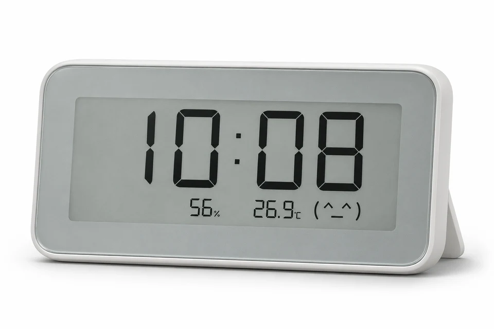
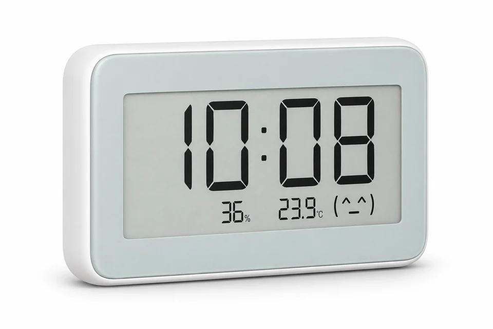
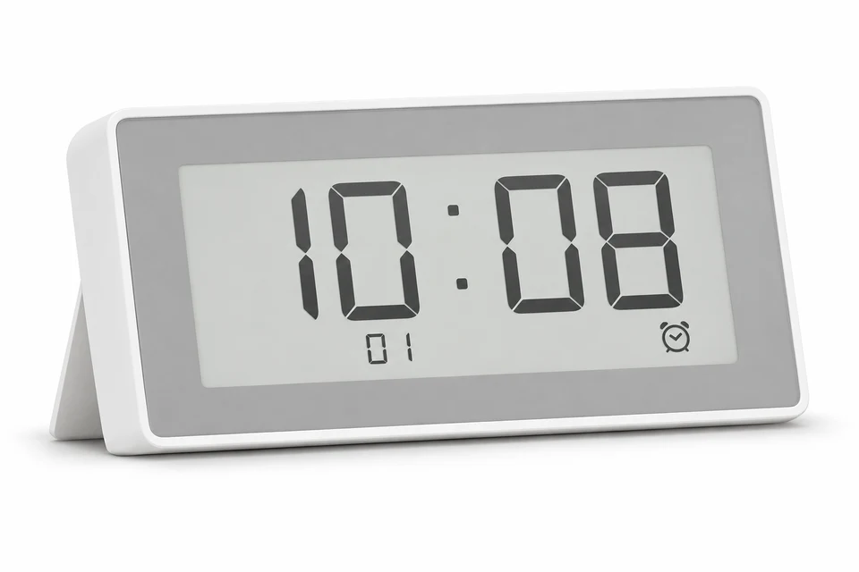
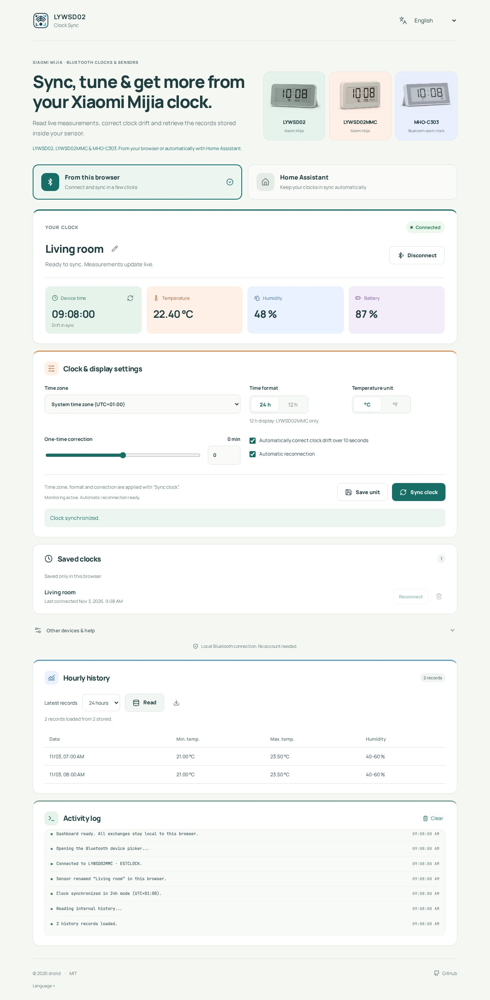
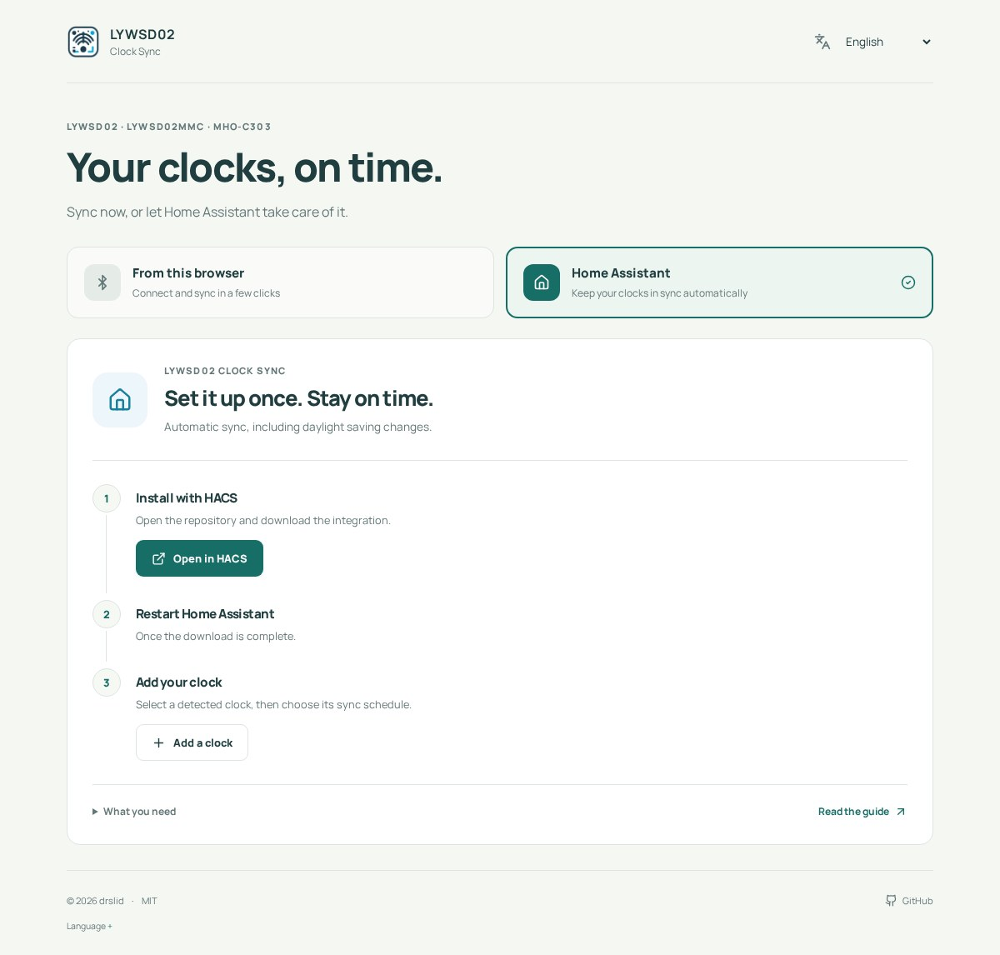

  

<h1 align="center">Xiaomi Mijia Clock Sync</h1>

<strong>Sync, tune &amp; get more from your LYWSD02, LYWSD02MMC and MHO-C303.</strong> Read live measurements, correct clock drift and retrieve the records stored inside your sensor.

<table>
  <tr>
    <td align="center"> <strong>LYWSD02</strong></td>
    <td align="center"> <strong>LYWSD02MMC</strong></td>
    <td align="center"> <strong>MHO-C303</strong></td>
  </tr>
</table>

AI product illustrations, based on device references. [Image credits and prompts](docs/IMAGE_PROMPTS.md).

| Sync from your browser | Automate with Home Assistant |
| --- | --- |
| Connect a nearby clock and set its time in a few clicks. | Install the integration once and let it sync your clocks automatically. |
| **[Open the dashboard](https://drslid.github.io/LYWSD02_BLE_Dashboard/#browser)** | **[Set up Home Assistant](https://drslid.github.io/LYWSD02_BLE_Dashboard/#home-assistant)** |

   
  Browser interface with example readings. Clock settings, interactive temperature/humidity history and the activity log are visible directly.

  <a href="#getting-started">Browser sync</a> ·
  <a href="#home-assistant">Home Assistant</a> ·
  <a href="#compatible-devices">Compatible devices</a> ·
  <a href="#connection-help">Connection help</a> ·
  <a href="#languages">Languages</a>

## Sync from your browser

Use **Chrome, Edge or another compatible Chromium browser** on a Bluetooth-enabled computer or Android device. Keep the clock nearby.

1. Open [the dashboard](https://drslid.github.io/LYWSD02_BLE_Dashboard/#browser) and choose **From this browser**.
2. Click **Connect a clock**, then select your device in the Bluetooth list.
3. Click **Sync clock**. Your computer’s time zone is selected automatically, and a confirmation appears when complete.

Temperature, humidity and battery appear after connecting. Use the pencil beside the clock’s name to rename it.

- **Clock & display settings**: time zone, 12/24-hour format, correction and automatic correction are visible directly. Click **Sync clock** to apply the time settings. Choose °C/°F and use **Save unit** to update the device’s unit. The 12-hour display is available on the LYWSD02MMC only.
- **Hourly history**, above the log: explore temperature and humidity charts for up to 96 hours. Hover, tap or use the arrow keys to inspect each hourly minimum/maximum; download the full readings as CSV.
- **Activity log**, at the bottom: follow Bluetooth connections, sync results and errors.
- **Other devices & help**: select an experimental profile before connecting.
- **Saved clocks**: reconnect to a previously used device. Names are saved only in this browser.

Automatic correction is enabled by default: drift over 10 seconds is corrected when you connect. You can turn it off in **Clock & display settings**.

Phones without Web Bluetooth can still use the **Home Assistant** tab. Browser sync requires a compatible browser; Safari and Firefox cannot connect. Android layout and interaction are covered by browser tests; physical BLE validation remains device-specific.

## ✨ What you can do

| | What it does |
| --- | --- |
| ⏰ **Keep the right time** | Synchronize the clock with your computer, select your time zone and correct clock drift automatically. |
| ⚙️ **Choose your display** | Switch between Celsius/Fahrenheit, and 12/24-hour time on the LYWSD02MMC. |
| 🌡️ **Check your room** | See live temperature and humidity, plus the sensor’s battery level. |
| 📊 **Read past measurements** | Retrieve up to 96 hourly records with minimum/maximum values and download them as CSV. |
| 🏷️ **Find your sensors again** | Save local names and reconnect from your device history. |
| 🔄 **Recover from a drop** | Retry automatically, up to 10 attempts. Stop a connection at any time. |
| 🏠 **Automate it** | Let [Home Assistant](#home-assistant) set every clock each night and after daylight saving changes. |

The connection is local. Measurements and saved sensor names stay in your browser, with no account or cloud service required.

## 📡 Compatible devices

The compatibility below applies to **original firmware**. Installing custom firmware such as PVVX changes the protocol, even on the same physical model.

| Model | Browser dashboard | Home Assistant |
| --- | --- | --- |
| **LYWSD02** | Supported; 24-hour display | Supported; 24-hour display |
| **LYWSD02MMC** | Supported, including 12/24-hour switching | Supported, including 12/24-hour switching |
| **MHO-C303** | Discovery and reconnection enabled using the shared protocol; physical browser validation pending | Tested on a physical clock: discovery, time sync, temperature, humidity, battery and hourly records |

Thank you to **[@drug123](https://github.com/drug123)** for contributing MHO-C303 support in [pull request #1](https://github.com/drslid/LYWSD02_BLE_Dashboard/pull/1) and [testing it on a physical clock in Home Assistant](https://github.com/drslid/LYWSD02_BLE_Dashboard/pull/1#issuecomment-6524401251), alongside an existing LYWSD02.

The MHO-C303 shares the time, measurement and history characteristics used by the integration. Its 12/24-hour setting and alarm functions have not been validated; alarm management is not provided by this project. Other Bluetooth thermometers are not automatically compatible: the device name and GATT protocol must match.

### Experimental devices and firmware

Version **1.4.0** adds separate BLE profiles based on published protocols. **These additions pass simulated tests but have not been tested on physical devices.** Before connecting in the browser, open **Other devices & help** and select the matching **Device / firmware** profile. The existing stock profile remains the default.

| Device / firmware | Browser dashboard | Home Assistant |
| --- | --- | --- |
| **PVVX BLE v4.7–v5.9**, recognized climate hardware: LYWSD03MMC, MHO-C401/C401N, CGG1/CGG1N, CGDK2, MJWSD05MMC variants, MHO-C122, LYWSD02MMC | Experimental time sync, unit, live readings and averaged sample history/CSV; 12/24 h only on matching hardware | Experimental clock sync/settings/readings; sample history is not imported as stock min/max statistics |
| **CGD1**, original firmware | Experimental time/timezone/unit/12–24 h and readings, using its **existing pairing token** | Experimental clock sync/settings/readings with the same token; no measured clock drift/read-back |
| **LYWSDCGQ / MJ_HT_V1**, **LYWSD03MMC**, **CGG1 ClearGrass variant**, **CGDK2**, original firmware | Experimental measurements; device clock/settings actions disabled | Use native Xiaomi BLE / Qingping, according to the device |
| **HHCCJCY01 / GCLS002** Flower Care and **HHCCPOT002** RoPot | Experimental soil measurements and battery; Flower Care also temperature and illuminance | Use native Xiaomi BLE / ESPHome |

PVVX must already be installed; this dashboard does not flash firmware. Identity/capability checks reject unknown PVVX hardware, unsupported versions and Zigbee builds. CGD1 session authentication preserves the existing pairing and unrelated settings; it does not configure alarms or ringtones. Factory CGG1 variants differ; the HomeKit variant is excluded. Update the HA integration to v1.4.0 to get the experimental PVVX/CGD1 clock profiles; factory sensor profiles are browser additions.

See the [complete research for all 20 ESPHome models, commands and limitations](docs/DEVICE_SUPPORT.md), and the [PVVX protocol and naming assessment](docs/PVVX_COMPATIBILITY.md). Home Assistant can receive appropriately configured PVVX BTHome broadcasts through its built-in [BTHome integration](https://www.home-assistant.io/integrations/bthome/). Other motion/contact/air-quality devices remain deferred until their active commands and authentication are verified; their supported broadcasts can already be used through native HA or ESPHome.

## 🏠 Keep every clock on time with Home Assistant

   
  A separate setup tab keeps Home Assistant installation apart from browser sync.

The **LYWSD02 Clock Sync** integration sets your **LYWSD02, LYWSD02MMC and MHO-C303** clocks from Home Assistant: right away when you add them, then every night at 04:00. After a daylight saving change, clocks are corrected within the hour, even without a schedule. Each sync also brings back what the clock measured: temperature, humidity, battery and its hourly records. Every setting is on the device page; there is nothing to write in YAML.

You need **Home Assistant 2025.2 or later**, **[HACS](https://www.hacs.xyz/)** and working **Bluetooth** in Home Assistant: a local adapter or an [ESPHome Bluetooth proxy](https://esphome.io/components/bluetooth_proxy/) with active connections.

1. **Add the integration to HACS**, then select **Download**:

   

2. **Restart Home Assistant.**
3. **Add your clocks.** Home Assistant discovers nearby **LYWSD02, LYWSD02MMC and MHO-C303** clocks: select **Add** on the notification. You can also add one yourself:

   

That’s it: each clock is synchronized immediately.

### Updating an existing Home Assistant installation

**[v1.5.1](https://github.com/drslid/LYWSD02_BLE_Dashboard/releases/tag/v1.5.1)** refreshes Bluetooth discovery between manual reconnection attempts, identifies whether a timeout happened while connecting or during a clock operation, and preserves failed sync attempts across restarts so retries can resume. Update through **HACS → LYWSD02 Clock Sync → Update**, then **restart Home Assistant**. Existing devices, schedules, entity IDs and statistics are preserved.

> Without HACS, copy `custom_components/lywsd02_sync` into the `custom_components` folder of your Home Assistant configuration, then restart.

### Set each clock from its device page

Open **Settings → Devices & services → LYWSD02 Clock Sync**, then select a clock. Its **Configuration** card holds every setting. Changes reach the clock right away, or as soon as it is in range.

| Setting | Choices |
| --- | --- |
| **Automatic sync** | **Every day** *(default)*, **Every week**, **Every month** or **Manual only** |
| **Sync time** | Time of the automatic sync, 04:00 by default |
| **Weekly sync day** | Day of the weekly sync |
| **Monthly sync day** | 1 to 28, so that every month has it |
| **Temperature unit** | °C or °F on the clock screen |
| **Time format** | 24 h or 12 h, on the LYWSD02MMC only |
| **Time correction** | Keeps the clock ahead (+) or behind (−) by up to 120 minutes |

Until you choose a temperature unit or time format here, the clock keeps its own.

For an advanced schedule, select **Configure** on the integration, then **Custom (cron expression)**: five fields, e.g. `30 3 * * 1` for every Monday at 03:30. Custom schedules keep **at least one hour** between two syncs, because each connection uses coin-cell energy.

Whatever you choose:

- **Daylight saving changes** are corrected within the hour.
- **A clock out of range** is looked for every minute and synchronized as soon as an adapter can reach it.
- **A missed scheduled run** is checked again every minute; retry delays are preserved after a failed connection. Manual, weekly and monthly schedules keep their chosen frequency.
- **Clocks scheduled at the same time** use a shared Bluetooth queue, one connection at a time. Notification cleanup and disconnects have a five-second deadline, so a stuck cleanup cannot hold all the other clocks indefinitely. Disk writes and statistics imports run outside this queue.
- **A failed connection** is retried after 30 seconds, 2, 5, 15 and then 60 minutes. Manual sync also reconnects after short delays while refreshing discovery.
- **Optional readings cannot consume the time-write deadline.** Each preliminary clock/history read has a three-second limit. After writing, a readable clock must agree with the requested time within five seconds; an ignored write triggers a retry. A write-only clock is marked as acknowledged without inventing a verified read-back.
- **Successful writes appear immediately**, while the remaining measurements/history finish loading for up to 30 seconds. Failed statistics imports are saved and retried every minute, including after restarting HA, without reconnecting to the clock.

### What you get

| Entity | What it shows |
| --- | --- |
| **Sync clock** button | Sets the clock now. If no adapter hears the clock, it looks for it for up to a minute; if the connection drops, it reconnects. Use it in dashboards and automations with `button.press`. |
| **Last sync** | When the clock was last set. |
| **Next sync** | When the next scheduled sync runs. |
| **Sync status** | *On time*, *Searching for the clock* or *Failed, retrying*. |
| **Temperature** and **Humidity** | What the clock measured during the last sync. The temperature follows the unit system of Home Assistant. |
| **Minimum** and **Maximum temperature (24 h)**, **Minimum** and **Maximum humidity (24 h)** | Extremes of the hourly records the clock kept during the 24 hours before the last sync. |
| **Battery** *(diagnostic)* | Battery level read during the last sync. |
| **Clock time** *(diagnostic)* | The time the clock showed right after the last sync, time correction included. |
| **Drift before last sync** *(diagnostic)* | How far the clock had drifted, in seconds. |

These readings change at each sync, so they follow the schedule you chose. For live values between syncs, the [Xiaomi BLE](https://www.home-assistant.io/integrations/xiaomi_ble/) integration of Home Assistant listens to what the clock broadcasts.

The clock keeps the minimum and maximum temperature and humidity of every hour. Each sync reads the hours recorded since the previous one (up to a week the first time) and adds them to the statistics of Home Assistant, even the hours between two syncs. To see them, add a **Statistics graph** card and choose **LYWSD02 (…) Temperature records** or **Humidity records**: each hour has its minimum, its maximum and, as the clock keeps no average, the midpoint between them as mean. Each record is placed on the hour it covers with the gap measured between the clock and Home Assistant before the time is set.

The settings are entities too, so automations can change them. The clock uses the time zone configured in Home Assistant. The integration speaks the nine languages of the dashboard.

### If a clock is not synchronized

- **Searching for the clock:** no Bluetooth adapter can reach it right now. Press **Sync clock** to look for it for up to a minute: it is synchronized as soon as an adapter hears it. After 5 minutes the log explains why, and **Settings → Repairs** shows what to do when the setup is the cause:
  - *Only heard by passive Bluetooth proxies*: enable connections on an ESPHome proxy near the clock with `active: true` under `bluetooth_proxy:`, or bring a Bluetooth adapter closer. Shelly devices only listen; they cannot set a clock.
  - *No Bluetooth adapter can connect*: add a Bluetooth adapter, or an ESPHome proxy with `active: true`.
  - Without a repair, the clock is out of range: move it closer to an adapter or proxy.
- **Failed, retrying:** a proxy may be out of connection slots. Home Assistant retries by itself; the **Sync clock** button reconnects a few times, then shows the exact error.
- **Last sync still says last week:** this timestamp is the last successful write, not the last attempt. On the **Sync status** sensor, inspect `last_attempt`, `last_error`, `next_retry`, `pending`, `in_progress` and `bluetooth_routes`. `clock_verified` distinguishes a measured read-back from an acknowledged-only write; `pending_record_imports` counts hours waiting for the recorder. Download integration diagnostics to retain the current state without its pairing token. The schedule is rechecked every minute. Missing clocks and connection failures trigger a ten-second active scan at most every five minutes on HA versions with that API; proxies configured only to listen still need `active: true` to connect.
- **The browser works but HA does not:** the dashboard connects through your computer's Bluetooth; HA needs an adapter or active proxy within range of the clock. Disconnect the dashboard before testing HA so an open browser session does not compete for the device's BLE connection.
- **Passive BLE Monitor updates normally, but clock sync cannot find any clocks:** check whether both integrations share one USB adapter. BLE Monitor controls the raw HCI scan separately from HA Bluetooth. Configure HA Bluetooth for **Active** scanning and set `active_scan: true` under `ble_monitor:` too, then restart HA after saving a backup. Opposing active/passive modes can prevent HA from receiving advertisements even when BLE Monitor still hears the clocks. See the [BLE Monitor explanation of shared-adapter conflicts](https://custom-components.github.io/ble_monitor/faq#conflicts-with-other-components-using-the-same-bt-interface). If sharing remains unreliable, dedicate separate adapters to the two scanners.
- **12 h has no effect:** only the LYWSD02MMC supports it. A plain LYWSD02 stays in 24 h and its time is still set.

## 🌍 Use the dashboard in your language

English is the default. Choose your language in the dashboard or open it directly below. Bookmark your language’s link to open it directly next time.

  <a href="https://drslid.github.io/LYWSD02_BLE_Dashboard/">English</a> ·
  <a href="https://drslid.github.io/LYWSD02_BLE_Dashboard/fr/">Français</a> ·
  <a href="https://drslid.github.io/LYWSD02_BLE_Dashboard/es/">Español</a> ·
  <a href="https://drslid.github.io/LYWSD02_BLE_Dashboard/it/">Italiano</a> ·
  <a href="https://drslid.github.io/LYWSD02_BLE_Dashboard/de/">Deutsch</a> 
  <a href="https://drslid.github.io/LYWSD02_BLE_Dashboard/ar/">العربية</a> ·
  <a href="https://drslid.github.io/LYWSD02_BLE_Dashboard/zh/">中文</a> ·
  <a href="https://drslid.github.io/LYWSD02_BLE_Dashboard/pt/">Português</a> ·
  <a href="https://drslid.github.io/LYWSD02_BLE_Dashboard/hi/">हिन्दी</a>

Arabic includes a right-to-left layout.

## 📡 Have more than one sensor?

Connect each sensor once and use the pencil beside its name to rename it. Open **Saved clocks** to find its name and last connection, then reconnect.

- **Reconnect** connects directly to a saved sensor when your browser allows it.
- **Select again** opens the browser’s device list. The dashboard checks that you chose the saved sensor before connecting.
- The **trash icon** removes a sensor from your dashboard history.

The names are saved in this browser. They do not rename entries in the browser’s Bluetooth chooser or follow you to another computer.

## 💬 Need help connecting?

- **The connection is taking too long:** click **“Stop connecting”**. It remains available during connection attempts and retry delays. If the browser’s device chooser is open, use its **Cancel** button.
- **The connection drops:** leave **Automatic reconnection** enabled for up to **10 attempts**. Turning it off prevents further retries.
- **Bluetooth is unavailable:** check that Bluetooth is turned on, use a compatible browser and open the [official dashboard](https://drslid.github.io/LYWSD02_BLE_Dashboard/) on your computer.
- **Something still looks wrong:** [report an issue](https://github.com/drslid/LYWSD02_BLE_Dashboard/issues/new) with your browser, operating system and the message shown in the activity log.

## 🤝 Help improve the dashboard

Found a bug, have a feature idea or spotted a translation to improve? [Open an issue](https://github.com/drslid/LYWSD02_BLE_Dashboard/issues). Contributions and pull requests are welcome.

For local setup, tests and device protocol details, see the [contributor and technical notes](docs/DEVELOPMENT.md).

## 👥 Contributors

Special thanks to [@drug123](https://github.com/drug123) for MHO-C303 compatibility and hardware testing ([#1](https://github.com/drslid/LYWSD02_BLE_Dashboard/pull/1)).

  
  

[All contributions on GitHub](https://github.com/drslid/LYWSD02_BLE_Dashboard/graphs/contributors).

Code released under the [MIT License](LICENSE). Third-party photos retain the licenses listed in [photo credits](docs/ASSET_CREDITS.md).

<a href="#top">⬆️ Back to top</a>

